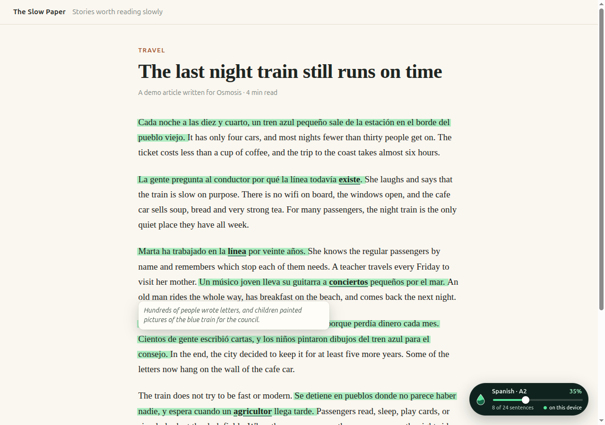

# Osmosis

**Learn a language from the web you already read.**

Osmosis is a Chrome extension that turns any English article into a graded reader at your level. A
share of the sentences on the page is rewritten in the language you are learning (Spanish,
French, German or Japanese, CEFR A1–B2), and the share follows a single dial. Each sentence is
picked so that it brings in about one word you don't know yet. Hover a sentence to see the
original and the new word. Click a word once you know it.

All of this runs **on your own computer**, with Gemini Nano in Chrome through **Firebase AI
Logic**. What you read is never uploaded. The cloud model (Gemini) is used only for jobs that
need no page text, such as turning the words you struggled with into a short story you can
listen to.



**Live:** <https://osmosis-hybrid.web.app> · demo article without the extension:
<https://osmosis-hybrid.web.app/read/night-train>

<!-- TODO before submission: YouTube link -->

## Why

Most language apps teach words. Learners get stuck when they try real reading, because real
reading is either too easy (still in English) or far too hard (a full foreign page).
Linguists call the sweet spot *comprehensible input*: text you understand almost entirely, with
one new thing in it (Krashen's *i+1*). Osmosis builds that text out of whatever you were going to
read anyway.

## How it uses Firebase AI Logic (hybrid)

Each feature gets an inference mode that matches **what data it touches**:

| Feature | Firebase AI Logic mode | What leaves the device |
| --- | --- | --- |
| Rewriting page sentences at your level | `ONLY_ON_DEVICE` (default) | Nothing. Verified with `npm run check:net` (see below). |
| Same, on a computer that can't run Gemini Nano | `PREFER_ON_DEVICE`, **only after you opt in** in the side panel | The sentences being translated, counted in the privacy ledger |
| Starter word list for your level | `ONLY_IN_CLOUD` | Language and level only |
| "Your reading, as a podcast" | `ONLY_IN_CLOUD` (Gemini text + Gemini TTS) | The list of words you lingered on. No page text, no URLs. |
| Web demo reader (our own article, for people without the extension) | `PREFER_ON_DEVICE` | The demo article's sentences, only if the browser has no on-device model |

On-device calls use a JSON-schema `responseConstraint`. The cloud calls use the same schema
through `responseJsonSchema`, so one validator handles both. `response.inferenceSource` is
recorded for every call and shown in the side panel's **privacy ledger**.

Cloud text calls go to `gemini-3.5-flash-lite`. When it reports "high demand", they retry with
backoff and then fall back to `gemini-3.5-flash` (`models.textFallback` in
`firebase.config.json`).

## What's inside

- **Content script** (`extension/src/content`): finds the article's paragraphs, splits sentences
  with `Intl.Segmenter`, translates paragraphs as they scroll into view (two at a time, paused in
  background tabs), and renders the dial and hover card in closed shadow roots.
- **Selection engine** (`extension/src/shared/select.ts`, unit-tested): which sentences to show is
  decided **in code, not by the model**.
  - A sentence is eligible only if its count of new words (by lemma, against your known-word set)
    is under the dial's cap.
  - Within a paragraph, *i+1* sentences win.
  - Density is spread over paragraphs in reading order, by error diffusion, so a sentence you're
    reading never flips back to English when a later paragraph finishes translating.
- **Level word lists** (`extension/src/shared/lexicon.ts`): a single request for 1,400 words
  is unreliable (the model often stops after about 100), so each level is built from 16 small
  requests, one per topic or part of speech, four at a time. The output is cleaned (articles,
  notes and romaji are removed) and deduplicated. Topics that fail are fetched the next time the
  panel opens.
  - Each level keeps its own list (`lex_<lang>_<level>`), apart from the words you marked
    yourself. Changing level swaps the list instead of stacking lists, and switching back costs
    nothing.
- **Validator** (`extension/src/shared/validate.ts`): the model's output is index-aligned and
  checked. Echoes of the English source are dropped, glossary words that don't occur in the
  translation are dropped, and missing sentences are retried one by one.
- **Service worker** (`extension/src/background/sw.ts`): handles all page translation. It holds a
  local translation cache and serialises calls to the on-device model. Content scripts never
  call a model themselves.
- **Side panel**: on-device model status and download, your word counts, the cloud features
  (starter word list, podcast and its audio), and the privacy ledger with the cloud-consent
  switch.
- **Web demo reader** (`web/`): the same content script running inside a normal page through a
  small `chrome.*` shim, for visitors who don't have the extension.
- **Opt-out**: a page with `<meta name="osmosis" content="off">` is left alone. The landing page
  uses this, because its hero is a hand-written specimen.

| Hover a sentence | Side panel |
| --- | --- |
|  |  |

## Run it

### 1. Firebase project

1. Create a Firebase project. Under **AI Logic**, choose the **Gemini Developer API**.
2. Register a **Web app** and copy its config into `firebase.config.json` (`firebase` key).
3. **App Check** (the AI Logic setup turns on enforcement for Firebase AI Logic):
   - **Web demo**: create a reCAPTCHA Enterprise key in Google Cloud ("Fraud Defense"). Make it a
     Web, score-based key for `localhost` and your Hosting domains. Register it for the web app
     under **App Check → Apps**, and put the site key in `firebase.config.json`
     (`recaptchaSiteKey`). Site keys are public.
   - **Extension**: under **Manage debug tokens**, add a debug token and put it in `.env.local`,
     which is never committed:
     ```
     APPCHECK_DEBUG_TOKEN=...
     ```
     The build puts the debug token only into the extension bundle, never into the public web
     bundle.

### 2. Build

```bash
npm install
npm run build        # → dist/extension (extension) and web/public/osmosis (web reader)
npm test             # unit tests (segmentation, validator, selection engine)
```

### 3. Load the extension

You need Chrome on a machine that meets the hardware requirements for Chrome's built-in AI
(Gemini Nano).

1. Open `chrome://extensions`, turn on **Developer mode**, click **Load unpacked**, and pick
   `dist/extension`. The extension ID is pinned by the manifest key:
   `jeeacnodnalnmbkaipineojgflbekmlg`.
2. Click the Osmosis icon to open the side panel. Choose a language and level, then download the
   on-device model if asked.
3. Open any English article. To try the demo article, run `npm run serve` and open
   <http://localhost:8771/read/night-train.html>.

### Checks against a real Chrome

`npm run chrome start` launches an isolated Chrome profile with the extension loaded. It uses
`/var/tmp/osmosis-chrome` and exposes DevTools on `127.0.0.1:9333`. With the demo server running:

| Command | What it proves |
| --- | --- |
| `npm run check:net` | Clears the translation cache, translates the whole demo article, and records every network request the service worker makes. It includes a deliberate request as a positive control. Expected: `control seen: true`, `network requests during translation: 0`. |
| `npm run check:ui` | Drives a real mouse through the reader: the shown sentences stay stable, hovering records a "peek", a click marks a word known and a second click undoes it, and moving the dial shows more sentences. |
| `npm run check:web` | With the extension, the extension owns the page. In a context without it, the web demo reader takes over. |
| `npm run check:lexicon` | Builds level word lists through the side panel: German B1 must come back complete (16 topics). Then Spanish A2 → B2 → A2 must end with the same known-word count, with the switch back served from storage (0 cloud calls). |
| `npm run check:cloud` | The side panel's cloud features against the real project: the starter word list (retried on transient 5xx), then a podcast episode with audio. Prints the privacy ledger. |
| `npm run check:webcloud` | The judge's case: a Chromium with no on-device model opens the demo article. The web reader gets an App Check token through reCAPTCHA Enterprise and translates through Gemini in the cloud. |

## Privacy

- Page text is translated on your device. The only exception is a computer that can't run
  Gemini Nano, and only after you switch on cloud fallback in the side panel.
- The translation cache, your word list and your settings stay in `chrome.storage.local`.
- Cloud features send only word lists (and your language and level). The privacy ledger shows,
  for today, the characters of page text and of word lists sent to the cloud, and the number of
  on-device and cloud calls.

## License

[Apache-2.0](LICENSE). The site's fonts (Newsreader, Schibsted Grotesk, Spline Sans Mono) are
under the SIL Open Font License 1.1, see [web/public/fonts/OFL.txt](web/public/fonts/OFL.txt).
