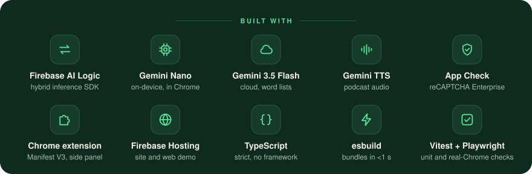
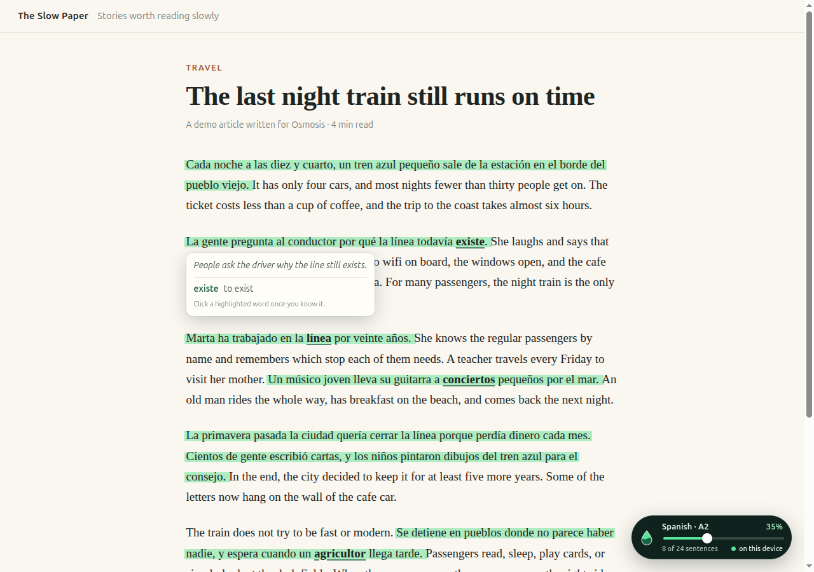
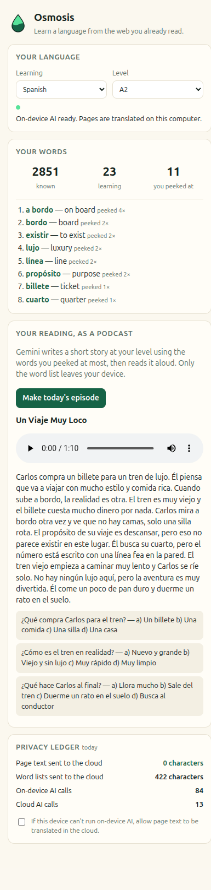

<p align="center">
  <picture>
    <source media="(prefers-color-scheme: dark)" srcset="web/public/logo-on-dark.svg">
    
  </picture>
</p>

<h1 align="center">Osmosis</h1>

<p align="center">
  <b>Learn a language from the web you already read.</b><br>
  A Chrome extension that turns English articles into a graded reader at your level,<br>
  with Gemini Nano running on your own computer through Firebase AI Logic.
</p>

<p align="center">
  <a href="https://youtu.be/uLlINhcut5o"><b>Demo video (2:43)</b></a> ·
  <a href="https://osmosis-hybrid.web.app">Website</a> ·
  <a href="https://osmosis-hybrid.web.app/read/night-train">Demo article (no install)</a> ·
  <a href="#run-it">Install</a> ·
  <a href="#checks-against-a-real-chrome">Checks</a> ·
  <a href="LICENSE">Apache-2.0</a>
</p>

<p align="center">
  
</p>

---

## What it does

Osmosis rewrites a share of the sentences on any English page into the language you are learning:
Spanish, French, German or Japanese, CEFR A1 to B2. Each sentence is picked so that it brings in
about one word you don't know yet.

- **Read**: the translated sentences are marked with a green highlighter, the rest stays English.
- **Hover** a sentence to see the original English and the new word.
- **Click** a word once you know it. It stops counting as new.
- **Turn the dial** to put more or less of the page in your language.
- **Listen**: the words you lingered on become a short story at your level, read aloud.

Page text is translated **on your computer** by Gemini Nano in Chrome, through Firebase AI Logic.
What you read is never uploaded. The cloud model is used only for jobs that need no page text.


## Why

Most language apps teach words. Learners get stuck when they try real reading, because real
reading is either too easy (still in English) or far too hard (a whole foreign page). Linguists
call the sweet spot *comprehensible input*: text you understand almost entirely, with one new
thing in it (Krashen's *i+1*). Osmosis builds that text out of whatever you were going to read
anyway.

## How it uses Firebase AI Logic (hybrid)

Each feature gets the inference mode that matches **the data it touches**:

| Feature | Firebase AI Logic mode | What leaves the device |
| --- | --- | --- |
| Rewriting page sentences at your level | `ONLY_ON_DEVICE` (default) | Nothing. Verified with `npm run check:net`. |
| The same, on a computer that can't run Gemini Nano | `PREFER_ON_DEVICE`, **only after you opt in** in the side panel | The sentences being translated, counted in the privacy ledger |
| Word list for your level | `ONLY_IN_CLOUD` | Language and level only |
| "Your reading, as a podcast" | `ONLY_IN_CLOUD` (Gemini text + Gemini TTS) | The words you lingered on. No page text, no URLs. |
| Web demo reader (our own article, for visitors without the extension) | `PREFER_ON_DEVICE` | The demo article's sentences, only if the browser has no on-device model |

- On-device calls use a JSON-schema `responseConstraint`. Cloud calls use the same schema through
  `responseJsonSchema`, so one validator handles both.
- `response.inferenceSource` is recorded for every call and shown in the side panel's
  **privacy ledger**.
- Cloud text calls go to `gemini-3.5-flash-lite`. When it reports "high demand", they retry with
  backoff and then fall back to `gemini-3.5-flash` (`models.textFallback` in
  `firebase.config.json`).

## How it works

| Part | Where | What it does |
| --- | --- | --- |
| Content script | `extension/src/content` | Finds the article's paragraphs and splits sentences with `Intl.Segmenter`. Translates paragraphs as they scroll into view (two at a time, paused in background tabs). Draws the dial and hover card in closed shadow roots. |
| Selection engine | `extension/src/shared/select.ts` | Decides which sentences to show **in code, not in the model**. A sentence is eligible only if its count of new words is under the dial's cap. Within a paragraph, *i+1* sentences win. Density is spread over paragraphs in reading order, so a sentence you are reading never flips back to English. |
| Level word lists | `extension/src/shared/lexicon.ts` | Builds each level's list from 16 small requests (one per topic or part of speech, four at a time), because one request for 1,400 words often stops after about 100. Output is cleaned and deduplicated. Each level keeps its own list, so changing level swaps lists instead of stacking them. |
| Validator | `extension/src/shared/validate.ts` | Checks the model's index-aligned output. Drops echoes of the English source and glossary words that don't occur in the translation. Retries missing sentences one by one. |
| Service worker | `extension/src/background/sw.ts` | Handles all page translation: a local translation cache and a queue for the on-device model. Content scripts never call a model themselves. |
| Side panel | `extension/src/sidepanel` | On-device model status and download, word counts, the podcast, and the privacy ledger with the cloud-consent switch. |
| Web demo reader | `web/` | The same content script inside a normal page through a small `chrome.*` shim, for visitors without the extension. |

A page with `<meta name="osmosis" content="off">` is left alone. The landing page uses this,
because its hero is a hand-written specimen.

| Hover a sentence | Side panel |
| --- | --- |
|  |  |

## Run it

### 1. Firebase project

1. Create a Firebase project. Under **AI Logic**, choose the **Gemini Developer API**.
2. Register a **Web app** and copy its config into `firebase.config.json` (`firebase` key).
3. Set up **App Check** (the AI Logic setup turns on enforcement):
   - **Web demo**: create a reCAPTCHA Enterprise key in Google Cloud ("Fraud Defense"): a Web,
     score-based key for `localhost` and your Hosting domains. Register it for the web app under
     **App Check → Apps** and put the site key in `firebase.config.json` (`recaptchaSiteKey`).
     Site keys are public.
   - **Extension**: under **Manage debug tokens**, add a debug token and put it in `.env.local`,
     which is never committed:
     ```
     APPCHECK_DEBUG_TOKEN=...
     ```
     The build puts the debug token only into the extension bundle, never into the public web
     bundle.

### 2. Build

```bash
npm install
npm run build        # → dist/extension (extension) and web/public/osmosis (web reader)
npm test             # unit tests (segmentation, validator, selection engine, word lists)
```

### 3. Load the extension

You need Chrome on a computer that meets the hardware requirements for Chrome's built-in AI
(Gemini Nano).

1. Open `chrome://extensions`, turn on **Developer mode**, click **Load unpacked** and pick
   `dist/extension`. The extension ID is pinned by the manifest key:
   `jeeacnodnalnmbkaipineojgflbekmlg`.
2. Click the Osmosis icon to open the side panel. Choose a language and level, then download the
   on-device model if asked.
3. Open any English article. For the demo article, run `npm run serve` and open
   <http://localhost:8771/read/night-train.html>.

## Checks against a real Chrome

`npm run chrome start` launches an isolated Chrome profile with the extension loaded
(`/var/tmp/osmosis-chrome`, DevTools on `127.0.0.1:9333`). With the demo server running:

| Command | What it proves |
| --- | --- |
| `npm run check:net` | Translates the whole demo article from an empty cache and records every network request the service worker makes, with a deliberate request as a positive control. Expected: `control seen: true`, `network requests during translation: 0`. |
| `npm run check:ui` | Drives a real mouse through the reader: shown sentences stay stable, hovering records a "peek", a click marks a word known and a second click undoes it, and the dial shows more sentences. |
| `npm run check:web` | With the extension, the extension owns the page. Without it, the web demo reader takes over. |
| `npm run check:lexicon` | German B1 word list comes back complete (16 topics). Spanish A2 → B2 → A2 ends with the same known-word count, and the switch back costs 0 cloud calls. |
| `npm run check:cloud` | The side panel's cloud features against the real project: the level word list, then a podcast episode with audio. Prints the privacy ledger. |
| `npm run check:webcloud` | The judge's case: a Chromium with no on-device model opens the demo article. The web reader gets an App Check token through reCAPTCHA Enterprise and translates through Gemini in the cloud. |

## Project layout

```
extension/
  public/          manifest, side panel page and styles, icons, logo
  src/background/  service worker: page translation, cache, on-device queue
  src/content/     reader, dial, hover card
  src/shared/      Firebase AI Logic calls, prompts, selection engine, validator, word lists
  src/sidepanel/   side panel: model status, word counts, podcast, privacy ledger
  test/            unit tests
web/
  public/          landing page, demo article, fonts
  src/             web demo reader (the content script plus a chrome.* shim)
scripts/           build, icons, real-Chrome checks, demo recording
video/             demo video pipeline (narration by ElevenLabs); not part of the app
```

## Privacy

- Page text is translated on your device. The only exception is a computer that can't run Gemini
  Nano, and only after you switch on cloud fallback in the side panel.
- The translation cache, your word lists and your settings stay in `chrome.storage.local`.
- Cloud features send only word lists, with your language and level. The privacy ledger shows,
  for today, the characters of page text and of word lists sent to the cloud, and the number of
  on-device and cloud calls.

## License

[Apache-2.0](LICENSE). The site's fonts (Newsreader, Schibsted Grotesk, Spline Sans Mono) are
under the SIL Open Font License 1.1, see [web/public/fonts/OFL.txt](web/public/fonts/OFL.txt).
All icons in this README were drawn for Osmosis.
